  <a href="https://www.lucasluz.dev/">lucasluz.dev</a> ·
  <a href="mailto:contato.lucaspmluz@gmail.com">contato.lucaspmluz@gmail.com</a> ·
  <a href="https://www.linkedin.com/in/lucas-luz-0b0368432/">LinkedIn</a>

